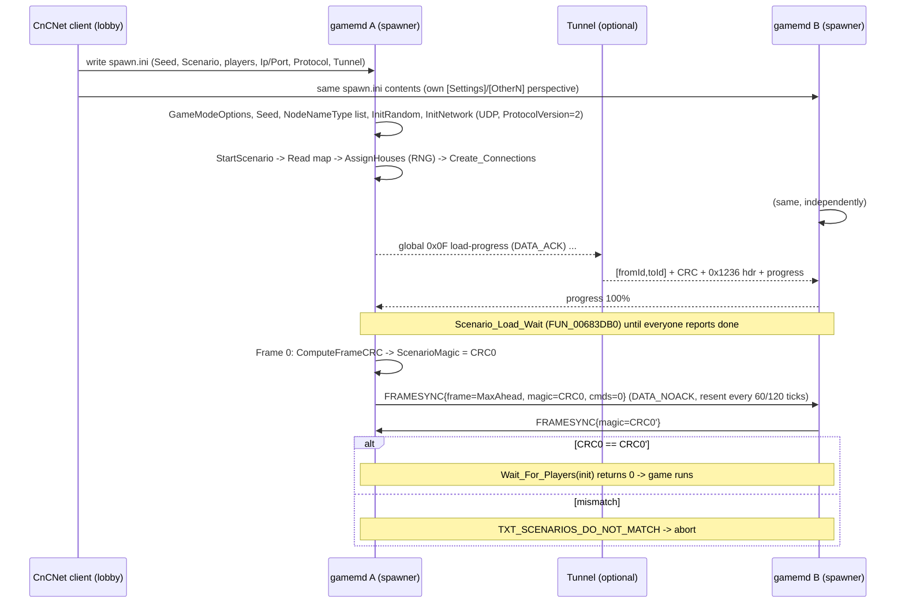

# Net / 01: the original game's multiplayer protocol (YR `gamemd.exe`, RA2 `game.exe`)

Read-only reverse-engineering report (agent N1). No engine code was changed.

* **Binary:** `D:\Red Alert 2\gamemd.exe`, YR 1.001, 4,808,976 bytes. This is the binary the repo's RE notes
  use (`docs/re/workflow.md`, SHA1 `7BE4E550...`). RA2 `game.exe` (4,485,392 bytes) was cross-checked for the
  constants in §9.
* **Tools:** Ghidra 11.2.1 headless, run on private project copies `D:\ra2-re\net1`, `net1b` and `net1c`
  (copied from `p4proj`). Scripts are in `D:\ra2-re\net1-scripts\` (`dec.py`, `decx.py`, `decrange.py`,
  `dis.py`, `str.py`, `xref.py`, `fnref.py`). Raw decompiles and dumps are in `D:\ra2-re\net1-out\`
  (`dec1.c` … `dec7.c`, `ipxrange.c`, `udprange.c`, `dis*.txt`, `strings1.txt`).
* **References used as hints only:** YRpp headers (`D:\ra2-re\reference\YRpp`), and CnCNet's
  `yrpp-spawner` source, which I cloned read-only to `D:\ra2-re\reference\yrpp-spawner` (GPL, not vendored).
  Every claim below cites an address in **this** binary unless it is marked *(spawner)* or *(YRpp)*.

> **Address drift warning.** YRpp and the CnCNet spawner target a different YR 1.001 build. Code addresses in
> this install are shifted non-uniformly, by up to about 0x5C0 in the 0x64xxxx range. Examples: YRpp
> `ComputeFrameCRC 0x64DAB0` is `0x64D520` here, and YRpp `Print_CRCs 0x64DEA0` is `0x64D8E0`. The `.bss`
> globals are shifted by a nearly constant **-0x1098** (YRpp `EventClass::OutList 0xA802C8` is `0xA7F230`
> here, YRpp `SessionClass::Instance 0xA8B238` is `0xA8A1A0`). The layer and object globals are shifted by
> -0x1080 to -0x1090. The wire protocol is the same; only the addresses move. Everything below uses
> **this binary's** addresses.

---

## TL;DR

1. **The whole game is one deterministic lockstep loop over UDP.** Every player sends its own commands
   (`EventClass`, 111 bytes in memory, 47 types) stamped with a future execution frame
   (`now + MaxAhead`, rounded up to a multiple of `FrameSendRate`). No frame executes until every peer has
   announced that it has reached that frame. There is no server and no authority. The "host" only picks the
   timing values.
2. **The wire stack is four layers deep, all of it custom.** Each UDP datagram is laid out as
   `[CnCNet tunnel hdr 4B, optional] [rotl-sum CRC32 4B] [Connection header 14B (game) / 16B (global)] [payload]`.
   Game traffic goes over a per-peer reliable channel (`ConnectionClass`: magic `0xAA04`, DATA_ACK, DATA_NOACK
   and ACK codes, retransmit plus dedupe). Lobby, chat, beacons, kick votes and load progress go over a separate
   "global" channel (magic `0x1236`, 455-byte `GlobalPacketType`).
3. **Commands are compressed (CommProtocol 2).** A packet is a 14-byte `FRAMEINFO` header (frame, frame CRC,
   command count, delay) followed by `[type][payload]` records. Payload sizes come from a fixed table at
   `0x81F8FC`. Runs of `MEGAMISSION` events are run-length coded, with a per-house cache of unit lists.
4. **The sync check is a cheap rolling checksum, compared 1:1 every packet.**
   `CRC = rotl1(CRC) + value` over the infantry, unit and building positions and facings, every object in the
   five map layers and in Logic, **plus one draw from `Scenario->Random`**. It is computed every frame. Each
   peer's `FRAMEINFO` carries its CRC for its send frame, and the receiver compares it with its own 256-entry
   history. A mismatch writes `SYNC<n>.TXT` and shows `TXT_OUT_OF_SYNC`, and the game ends.
5. **The frame-0 CRC is also a "same map" check.** It is echoed in every `FRAMESYNC` packet. If it differs, the
   game shows `TXT_SCENARIOS_DO_NOT_MATCH` before a single command runs. **A compatible client has to agree
   with the original game bit for bit at frame 0, before any input happens.**
6. **There is no rejoin.** "Reconnect" is a stall dialog: packets are retransmitted, a countdown runs, and
   players can vote to kick. A dropped player is removed with a `REMOVEPLAYER` event and their house is
   defeated. There is no state transfer and no late join. Multiplayer **save** exists: a `SAVEGAME` event makes
   every client save locally (`SAVEGAME.NET`).
7. **CnCNet does not use the in-game lobby.** The CnCNet client writes `spawn.ini`, and `yrpp-spawner`
   (injected into `gamemd`) fills `SessionClass` and `GameModeOptionsClass` directly, then calls
   `Create_Connections`. It also adds a non-vanilla event `0x30 ResponseTime2` ("Protocol 0" latency levels).
   It rewrites `sendto`/`recvfrom` through the CnCNet tunnel (4-byte id header).
8. **Feasibility.** The wire layer on its own (transport, event codec, scheduler, chat and session glue) is
   about **6 to 10 engineer-weeks** of well-specified work. It is **useless on its own**: the frame-0
   `FRAMESYNC` check and the per-frame CRC need exact positions, facings, object `UniqueID`s and RNG draws
   (N3's domain). Without bit-exact simulation a mixed game ends at frame 0 with "scenarios do not match".

---

## 1. Global state map (this binary)

| What | Address | YRpp equivalent / notes |
|---|---|---|
| `SessionClass Session` | `0xA8A1A0` | YRpp `0xA8B238` (-0x1098). `+0x00` GameMode (0 campaign, 1/2 serial or modem, 3 LAN, 4 Internet/WOL, 5 skirmish) |
| `Session.CommProtocol` ("ProtocolVersion") | `0xA8A1B4` (`+0x14`) | 0 = raw 111-byte events, 1 = compressed, 2 = compressed and FrameSendRate-quantised. Always 2 in practice (set at `0x5E35A0`, spawner forces 2) |
| `GameModeOptionsClass` | `0xA8A1B8` (`+0x18`) | Money `+0x0C`, Crates `+0x11`, ShortGame `+0x12`, SWAllowed `+0x13`, BuildOffAlly `+0x14`, GameSpeed `+0x18`, UnitCount `+0x20`, MCVRedeploy `+0xD0` |
| `Session.MPlayerCount` | `0xA8A4B4` | |
| `Session.MaxAhead` | `0xA8A4B8` | YRpp `0xA8B550` |
| `Session.FrameSendRate` | `0xA8A4BC` | |
| `Session.DesiredFrameRate` | `0xA8A4C0` | set by `TIMING` |
| ProcessTimer / Ticks / Frames | `0xA8A4C4/C8/CC` | per-frame wall-clock accounting, main loop `0x55CFF0` |
| MaxMaxAhead / PrecalcMaxAhead / PrecalcFPS | `0xA8A4D0/D4/D8` | |
| `Session.MPStats[8]` (0x68 each) | `0xA8A4DC` | round trip, resends, lost, stalls (dumped into `SYNC*.TXT`) |
| `Session.LoadGame` / `+0x684` flag | `0xA8A820` / `0xA8A824` | gate the frame-0 resync and the scenario-CRC magic |
| `Session.Players` (`DynamicVectorClass<NodeNameType*>`) | items `0xA8C9E0`, count `0xA8C9EC` | YRpp calls it `StartSpots` (`Session+0x283C`). Node 0 is the local player |
| `Session.MasterPlayerID` / name | `Session+0x3074` / `+0x3020` | used by `Am_I_Master` `0x697880` |
| Record/Play/Attract bits | `0xA8C560` (`Session+0x23C0`) | bit 1 = record events to file, bit 2 = play back |
| Global receive packet / ProductID | `0xA8C5A0` / `0xA8C778` | YRpp `0xA8D638` |
| `Frame` (game frame counter) | `0xA8DCEC` | YRpp `Unsorted::CurrentFrame 0xA8ED84` |
| `Seed` | `0xA8DCFC` | YRpp `0xA8ED94` |
| `SpecialDialog` | `0xA8DD08` | `OPTIONS` sets 1 (all players' games open the menu, which pauses everyone), `PAGEUSER` sets 7 |
| `GameSpeed` (global) | `0xA8DAC8` | set by `GAMESPEED` |
| `LatencyFudge` | `0xA8CB04` | set by `LATENCYFUDGE` |
| `ViaPacketRouter` (WOL pserver) | `0xA8CB08` | obsolete Westwood packet router; 0 under CnCNet |
| Scenario magic (frame-0 CRC) | `0xA8D710` | sent in every `FRAMESYNC` |
| `IPXManagerClass` instance | `0xA8D928` | ctor `0x540620`, static init `0x4E7FB0` |
| `UDPInterfaceClass*` | `0x8865A8` | vtable `0x7F6A6C` |
| `ScenarioClass*` | `0xA8A198` | `+0x000` SpecialFlags (bit 12 = FogOfWar), `+0x218` `Random` (R250 generator, 253 dwords) |
| `HouseClass::Array` | items `0xA7F194`, count `0xA7F1A0` | house `+0x30` ArrayIndex, `+0x1EC` IsHumanPlayer, `+0x1ED` IsInPlayerControl, `+0x1602A` UIName |
| `PlayerPtr` (local house) | `0xA82CB4` | |
| `EventClass::OutList` | Count `0xA7F230`, Head `+4`, Tail `+8`, Array `0xA7F23C`, Timings `0xA829BC` | `QueueClass<EventClass,128>` |
| `EventClass::DoList` | Count `0x8B3160`, Head `+4`, Tail `+8`, Array `0x8B316C`, Timings `0xA6F16C` | `QueueClass<EventClass,16384>` |
| `MegaMissionList` | Count `0xA82E38`, Head `0xA82E3C`, Tail `0xA82E40`, Array `0xA82E44` | 256 entries |
| `MegaMissionTargetNum[8*8]` / `MegaMissionTargets[64][128]` | `0xAC4064` / `0xAF93D0` | megamission unit-list cache |
| `CurrentFrameCRC` / `LatestFramesCRC[256]` | `0xAC4164` / `0xB033DC` | |
| `EnableMPSyncDebug` | `0xB037E8` | "extra sync logging" |
| Event size table `[47]` | `0x81F8FC` | §3.2 |
| Event name table `[47]` | `0x81F92C` | `"EMPTY"`, `"POWERON"`, … |
| Wait timeouts `[GameMode][4]` | `0x836338` | §4.4 |
| Default UDP ports | `0x840ED0..DC` | 1234 (game), 1235, 1236, 1237 (router and forwarding) |

---

## 2. Transport layer (bytes on the wire)

### 2.1 UDP datagram (`UDPInterfaceClass`, vtable `0x7F6A6C`)

* **Message handler:** `FUN_007B28A0` (vtable `+0x40`). It handles `WM 0x474/0x475` (FD_READ, FD_WRITE).
  * Send: `sendto(sock, buf+0x1C, len+4, …)`.
  * Receive: `recvfrom(…, 0x280)`, then the length minus 4.
* **Buffer type:** `WinsockBufferType` (0x2A0 bytes). The datagram is
  `[u32 CRC][payload ≤ 636]` (buffer `+0x1C` CRC, `+0x20` data).
* **CRC routines:** build `FUN_007B0DD0` (vtable `+0x54`), check `FUN_007B0E50` (vtable `+0x58`). Both use
  `Add_CRC` `FUN_0064D8C0`:
  ```
  crc = 0
  for each full little-endian u32 w in payload: crc = ((crc << 1) | (crc >> 31)) + w     // rotl1 then add
  if (len & 3): w = u32 read at tail & (0xFFFFFFFF >> (32 - 8*(len&3))); crc = rotl1(crc) + w
  ```
  * A packet with a bad CRC, or `len >= 0x280`, is dropped ("Error in Winsock packet CRC" or "Throwing away
    malformed packet").
  * `FUN_007B1530` together with `FUN_0065C220(0,99)` is a debug packet-loss simulator, off by default.
* **Addresses:** the game keeps addresses as 12-byte `IPAddressClass` values (IPv4 address and port). Port 0
  means the default `0x4D2` (1234).
* **CnCNet tunnel (spawner `NetHack.cpp`):** it replaces the `sendto`/`recvfrom` calls at the
  `UDPInterfaceClass::Message_Handler` call sites, which are `0x7B3D75` and `0x7B3EEC` in the YRpp build and
  `0x7B2B75` and `0x7B2CEC` here.
  * The node address `sin_addr` is set to the player index (1..7). The real IP and port live in the spawner's
    `ListAddress[]`.
  * In tunnel mode a 4-byte header is prepended: `[u16 fromId][u16 toId]`. Both are the network-order `Port=`
    values from `spawn.ini`. Packets are sent to `[Tunnel] Ip:Port`.
  * Received packets must have `toId == own id` and at least 5 bytes.
  * Without a tunnel the game sends plain peer-to-peer UDP to each player's `Ip:Port`.

### 2.2 Private (game) channel: `ConnectionClass` / `IPXConnClass`

Private connections are created by `IPXManagerClass::Create_Connection` `FUN_00540AF0`, which `Create_Connections`
`0x697580` calls once per remote node. The constructor is `FUN_0053F160`, which in turn calls `FUN_0048BD70`.

* Magic = `IPXManager.ProductID` = **`0xAA04`** (YR). It is pushed at `0x4E7FB0`.
* Queue size 32 packets each way. Max payload 558 bytes (`0x22E`), plus the 14-byte header.
* Default timing: RetryDelta 2, MaxRetries -1, Timeout 60. All in 60 Hz ticks (`FUN_006C82C0`).

Header (14 bytes, built in `Send_Packet` `FUN_0048BE50`, parsed in `Receive_Packet` `FUN_0048BF50`):

| Off | Size | Field |
|---|---|---|
| 0 | u16 | MagicNumber `0xAA04` (LE bytes `04 AA`) |
| 2 | u8 | Code: 0 = DATA_ACK (reliable), 1 = DATA_NOACK, 2 = ACK |
| 3 | u8 | router forward byte (WOL pserver only, else 0) |
| 4 | u32 | PacketID: separate counters for ACK'd (`conn+0x40`) and NOACK (`conn+0x3C`) |
| 8 | 6 | not written by the sender (stale buffer bytes). Receivers ignore them; send 0 |
| 14 | … | payload: an event packet (§3) |

Reliability:

* **Send queue** (`Service_Send_Queue` `FUN_0048C2F0`):
  * An unACKed entry is resent when `now - lastSent > RetryDelta`.
  * DATA_NOACK entries are dropped after the first send.
  * An entry fails after MaxRetries tries, or after `Timeout` ticks since its first send. A failure marks the
    connection bad ("ConnectionClass::Service_Send_Queue bad connection"). `IPXManager::Service` `FUN_00541550`
    then records `BadConnection`.
  * Round trip is measured from the DATA_ACK to the ACK (`FUN_0048B920`). `Response_Time` is
    `FUN_0048B990`.
* **Receive:**
  * DATA_ACK is queued unless its PacketID is already queued or below the in-order high-water mark
    (`conn[0x11]`). It is **always** ACKed with a 14-byte header carrying Code 2 and the same PacketID.
  * DATA_NOACK is queued as is. Its PacketID gaps drive the "% lost" statistic.
  * Delivery is at-least-once with dedupe. There is no reordering buffer.
* **Timing is retuned during play:**
  * `Queue_AI_Multiplayer` calls `Set_Timing(RT+10, -1, max(8*RT+15, 120))` every 128 frames
    (`0x647090`, `vtable+0x34`). RT is the response time scaled by `LatencyFudge`.
  * The spawner sets `(60, -1, 600)` at start.

### 2.3 Global channel: `IPXGlobalConnClass`

Built in `IPXManagerClass::Init` `FUN_005407B0` through `FUN_0053F7C0`.

* Magic **`0x1236`**.
* Payload `GlobalPacketType` of **0x1C7 = 455 bytes**. The ProductID is appended in the header.
* The router channel uses magic `0xCDEF` (WOL pserver only).

Header (16 bytes, `FUN_0053F900`): `u16 magic 0x1236, u8 code, u8 0, u32 PacketID, u32 0, u16 0, u16 ProductID 0xAA04`.

* ACKs are 16 bytes.
* Duplicates are filtered with a ring of (address, PacketID) (`FUN_0053F9E0`).
* `Send_Global_Message(buf, len, ack_req, addr, …)` is `FUN_00540E20`.
* `IPXManager::Service` `FUN_00541550` demultiplexes every datagram on the first u16: `0x1236` goes to the
  global channel, the router magic to the router channel, and `ProductID` to the private connection matched by
  sender address. It also does NAT port-change fix-ups.

### 2.4 What the RA2/YR split means

`game.exe` (RA2) uses **ProductID `0xAA03`** (`push 0xAA03` at file offset `0xD48D5`). Its event table has 46
types (no `ABANDON_ALL`). RA2 and YR peers therefore filter each other out at the magic check and cannot
interoperate. Our clone runs on the YR rules (`decision-yr-data-set.md`), so `0xAA04` is the right target.

---

## 3. Event layer

### 3.1 `EventClass` (111 bytes, packed)

The layout matches YRpp `EventClass.h` (`sizeof == 111`, data at +7). It was confirmed by the copy loops
(`0x1B` dwords plus 3 bytes), and by `FUN_004C6640` and the constructors.

| Off | Size | Field |
|---|---|---|
| 0 | u8 | Type (`EventType`, 0..0x2E vanilla) |
| 1 | u8 | bit 0 IsExecuted (local only, cleared on send) |
| 2 | i8 | HouseIndex (sender's `HouseClass::ArrayIndex`) |
| 3 | u32 | Frame: the execution frame |
| 7 | 104 | union payload (only `size[type]` bytes are meaningful) |

`TargetClass` on the wire is 5 bytes: `u32 id` (low 24 bits significant; it resolves through the object's
UniqueID) followed by `u8 RTTI` (`AbstractType`). The compressor's debug print `0x64B0D0` formats it as
`rtti<<24 | id&0xFFFFFF`.

### 3.2 Event types and payload sizes

The sizes are the table dump at `0x81F8FC`. The executor is `EventClass::Execute` `FUN_004C6BD0`, a switch at
`0x4C6BF7`.

| # | Name | Bytes | Payload layout (offsets into data) | Exec notes |
|---|---|---|---|---|
| 00 | EMPTY | 0 | | |
| 01 | POWERON | 5 | Target | |
| 02 | POWEROFF | 5 | Target | |
| 03 | ALLY | 4 | i32 HouseID | toggles alliance |
| 04 | MEGAMISSION | 23 | Whom 5, Mission u8, *slot* u8 (see §3.4), Target 5, Dest 5, Follow 5, IsPlanning u8 | buffered into MegaMissionList, then grouped (`FUN_0064C810`) |
| 05 | MEGAMISSION_F | 24 | Whom 5, Mission u8, Target 5, Dest 5, i32 Speed, i32 MaxSpeed | |
| 06 | IDLE | 5 | Whom | |
| 07 | SCATTER | 5 | Whom | |
| 08 | DESTRUCT | 0 | | house self-destruct (`FUN_004FC7A0`) |
| 09 | DEPLOY | 5 | Whom | |
| 0A | DETONATE | 5 | Whom | |
| 0B | PLACE | 16 | i32 RTTI, i32 HeapID, i32 IsNaval, CellStruct (i16 x, i16 y) | `FUN_004FAF00` |
| 0C | OPTIONS | 0 | | `SpecialDialog = 1` (MP pause menu) |
| 0D | GAMESPEED | 4 | i32 speed | sets `0xA8DAC8` and prints a message |
| 0E | PRODUCE | 12 | i32 RTTI, i32 HeapID, i32 IsNaval | `Begin_Production` `FUN_004FA170` |
| 0F | SUSPEND | 12 | same | `FUN_004FA730` |
| 10 | ABANDON | 12 | same | `FUN_004FCCA0` |
| 11 | PRIMARY | 5 | Whom | |
| 12 | SPECIAL_PLACE | 8 | i32 SWIdx, CellStruct | superweapon launch `FUN_004FAC70` |
| 13 | EXIT | 0 | | player quits; Execute_DoList handles it specially (§4.6) |
| 14 | ANIMATION | 16 | i32 AnimID, i32 HouseID, Point2D | |
| 15 | REPAIR | 5 | Whom | |
| 16 | SELL | 5 | Whom | |
| 17 | SELLCELL | 4 | CellStruct | walls |
| 18 | SPECIAL | 4 | `ScenarioFlags` | overwrites `Scenario->SpecialFlags` |
| 19 | FRAMESYNC | 0 | (packet-level only, §3.3) | never queued |
| 1A | MESSAGE | 0 | | unused (chat is out-of-band, §6) |
| 1B | RESPONSE_TIME | 1 | **byte stored at data+6** (event `+0x0D`) | `MaxAhead = byte` |
| 1C | FRAMEINFO | 7 | u32 CRC, u16 CommandCount, u8 Delay | sync check (§5) |
| 1D | SAVEGAME | 0 | | all clients save `SAVEGAME.NET` (§7) |
| 1E | ARCHIVE | 10 | Target, Target | |
| 1F | ADDPLAYER | 4 | u32 length, then *length* bytes of extra data on the wire | heap blob; vanilla executes it as a no-op |
| 20 | TIMING | 5 | u16 DesiredFPS, u16 MaxAhead, u8 FrameSendRate | §4.3 |
| 21 | PROCESS_TIME | 2 | u16 avg ms per frame | stored in `NodeNameType.Time` (`+0x73`) |
| 22 | PAGEUSER | 0 | | `SpecialDialog = 7` |
| 23 | REMOVEPLAYER | 4 | i32 HouseID | house defeated (`FUN_004FC7A0`) |
| 24 | LATENCYFUDGE | 4 | i32 | sets `0xA8CB04` |
| 25 | MEGAFRAMEINFO | 104 | router-only | |
| 26 | PACKETTIMING | 64 | router-only | |
| 27 | ABOUTTOEXIT | 0 | | host migration under WOL router |
| 28 | FALLBACKHOST | 4 | i32 | |
| 29 | ADDRESSCHANGE | 5 | i8 PlayerID, u32 addr | |
| 2A | PLANCONNECT | 10 | Target, Target | planning mode |
| 2B | PLANCOMMIT | 0 | | |
| 2C | PLANNODEDELETE | 5 | Target | |
| 2D | ALLCHEER | 4 | | |
| 2E | ABANDON_ALL | 12 | RTTI, HeapID, IsNaval | YR only |
| 30 | *ResponseTime2* | 2 | i8 MaxAhead, u8 LatencyLevel | **CnCNet spawner only** (§8.3) |

### 3.3 Packet body (CommProtocol 1/2): `Send_Packets` `FUN_00649710`, `Add_Compressed_Events` `FUN_0064B0D0`

```
off 0  u8  0x1C (FRAMEINFO)
off 1  u8  0
off 2  i8  my HouseIndex
off 3  u32 Frame = P2 ? ceil((Frame + MaxAhead)/FSR)*FSR : Frame + MaxAhead
off 7  u32 CRC = CurrentFrameCRC (CRC of *this* frame, §5)
off 11 u16 CommandCount = total commands I have sent so far (cumulative, 0xAF936A)
off 13 u8  Delay = MaxAhead  -> receiver derives "sender's frame" = Frame - Delay
off 14 ... records: [u8 type][size[type] bytes]   (house and frame inherited from the header)
           type 0x1F: [0x1F][u32 len][len bytes]
           type 0x04: [0x04][u8 count][23-byte payload]{[5-byte Whom] x (count-1)}   (§3.4)
           type 0x1B: [0x1B][1 byte]   (taken from and stored to event+0x0D)
```

* The decoder is `Extract_Compressed_Events` `FUN_0064B840`.
  * It walks the records until fewer than `size+1` bytes remain.
  * It enqueues the `FRAMEINFO` itself into the DoList first.
  * A `0x19` type at the start means a `FRAMESYNC` packet. It is skipped (handled earlier).
* `FRAMESYNC` (`FUN_00649A70`, 14 bytes, NOACK) has the layout
  `0x19, 0, house, Frame (same rule as above), u32 ScenarioMagic (0xA8D710), u16 CommandCount, u8 MaxAhead`.
* **Packets carrying commands are sent DATA_ACK. Empty `FRAMEINFO`-only packets and `FRAMESYNC` are sent
  DATA_NOACK** (decided by a local flag in `FUN_00649710`; `0x649A70`).
* A packet is filled from the OutList until the 558-byte payload is full. Several packets per frame are
  possible.
* CommProtocol 0 (uncompressed, used only for serial and very old builds) sends a full 111-byte `FRAMEINFO`
  followed by full 111-byte events.

### 3.4 MEGAMISSION run-length and unit-list cache

Consecutive `MEGAMISSION`s from the OutList are merged into one run. Run membership compares Mission, Target and
Destination (inside `FUN_0064B0D0`). Only the `Whom` differs inside a run. Byte 6 of the payload (the YRpp `_gap_`) is a
**cache slot (0..7)**.

Decoder rules:

| count | Meaning |
|---|---|
| ≥ 2 | Expand to *count* events. Store the Whom list in `MegaMissionTargets[house*8+slot]` (128 max) |
| 0 | Replay the cached list for `[house*8+slot]` with this payload |
| 1 | Single event |

The encoder's "early repeat" search is `FUN_0064AF40`. A compatible **encoder** may always send explicit lists
(count ≥ 1). A compatible **decoder** must implement the cache, because peers will send `count = 0`.

### 3.5 Queues

* `OutList` holds 128 local commands. UI code fills it through `OutList.Add`.
* `DoList` holds 16384 entries and is everyone's queue, including the local player's own echoed commands
  (`Send_Packets` copies its own events into the DoList at send time, with the same frame).
* After execution, entries with `IsExecuted` set or `Frame < now` are popped from the head (end of `FUN_00647090`).

---

## 4. Frame scheduling

### 4.1 Main loop (per game frame) and where networking sits

Main loop `FUN_0055CFF0`:

1. `0x55AC40` runs, presumably the logic and AI update. This is not verified; it runs **before** the queue
   step.
2. ProcessTicks and ProcessFrames are accumulated from `timeGetTime` (capped at 1000 ms).
3. **`Queue_AI` `FUN_00646D00` runs (call at `0x55DA6D`).** It dispatches on GameMode:
   * Modes 1-4 go to `Queue_AI_Multiplayer` `FUN_00647090`.
   * Modes 0 and 5 move the OutList straight into the DoList and run `Execute_DoList`. **No CRC is computed in
     single-player**, except during playback.
4. `++Frame`.

Inside `Queue_AI_Multiplayer` `FUN_00647090`:

```
ComputeFrameCRC()            // FUN_0064D520 -> CurrentFrameCRC (0xAC4164); also draws Scenario->Random (x2, §5)
LatestFramesCRC[Frame&255] = CRC
if Frame==0 or LoadGame:     // initial sync
    ScenarioMagic = SaveFlag ? 0 : CRC
    Send FRAMESYNC; Wait_For_Players(init=1, resend=T.a, dialog=T.b, total=T.d)  -> on fail abort
else every 128 frames:  Set_Timing(...); queue PROCESS_TIME(avg ms/frame)
if I am master (Am_I_Master 0x697880) and (precalc set or (Frame&0xFF)==0): queue TIMING   (§4.3)
if CommProtocol==2 and Frame % FSR != 0: service connections and return   // only send on FSR boundaries
Send_Packets(MaxAhead, cmdcount)                         // FUN_00649710
Wait_For_Players(init=0, resend=180, dialog=max(T.c, 3*RT), total=T.d)   // FUN_00648180
if Record: log this frame's events (FUN_0064D450)
Execute_DoList()                                          // FUN_0064BDF0 -> 0 on desync -> game ends
pop executed / stale entries
```

### 4.2 Waiting (the "lockstep gate"): `Wait_For_Players` `FUN_00648180`

Per-connection state is an array at `0xAF92C0` with a 0x18 stride:

| Field | Meaning |
|---|---|
| `[0]` | their frame (`= pkt.Frame - pkt.Delay`, max seen) |
| `[1]` | commands they announced (u16 CommandCount, max) |
| `[2]` | commands received |
| `[3]` | RTT sample |
| `[4]` | router RTT |
| `[5]` | last receive time |

`Process_Receive_Packet` `FUN_00649B30` updates these fields for every received game packet.

* **Proceed condition** (normal frame): `Frame < min_peers(theirFrame) + MaxAhead` **and** for every peer
  `received >= announced`.
* If not, the frame stalls:
  * The stall is counted as a frame-sync stall (`MPStats +0x54`) or a command-count stall (`+0x58`).
  * The loop keeps servicing the network: up to 64 packets per pass, then `Call_Back`, then a redraw.
  * `FRAMESYNC` is resent every *resend* ticks.
* Initial sync (`init=1`) proceeds when every peer has been heard from.
* After *dialog* ticks, the **reconnect dialog** opens (`FUN_0064A8C0`, strings `TXT_RECONNECTING_TO`,
  `TXT_WAITING_FOR_CONNECTIONS`, `TXT_RECONNECT_HELP*`). It shows a countdown, names the slowest player, and
  has per-player kick buttons.
* A kick proposal is global packet `0x1C` (§6), handled by `FUN_0064A550` and `FUN_0064A780`.
  * A player is kicked when votes ≥ `players-1` (checked in `FUN_00648180`).
  * Kicking calls `Kick_Player` `FUN_0064ACB0`, then `Destroy_Connection`.
  * "Outvoted player is me" kicks everyone else instead.
* After *total* ticks: if this is the initial sync, return 7 (fail). Otherwise call `FUN_0064AE80`
  (timeout or kick logic).
* Return codes:

  | Code | Meaning |
  |---|---|
  | 0 | proceed |
  | 2 | `FRAMESYNC` magic mismatch (`TXT_SCENARIOS_DO_NOT_MATCH`) |
  | 3 | DoList full |
  | 7 | timeout |
  | 8 / 9 | user left from the dialog |

### 4.3 MaxAhead, FrameSendRate and the host's `TIMING` event (`0x64762C..0x6479C4`)

Every player sends `PROCESS_TIME` every 128 frames: the average ms per frame. The master then computes:

* `fps = clamp(min over players 1000/Time, 1..)`. The cap comes from the game speed: speed 0 gives 60,
  speed 1 gives 45, and higher speeds give `60/speed`.
* `RT` = the worst response time in ticks. Under the router it comes from the router stats; otherwise it is
  `IPXManager.Response_Time()`.
* `LatencyFudge` adjusts RT as follows:

  | LatencyFudge | RT multiplier | Frames added |
  |---|---|---|
  | 1 | ×1.5 | +10 |
  | 2 | ×2 | +20 |
  | 3 | ×3 | +30 |

* `FSR = Session.FrameSendRate`. On the **Internet** it is forced to **10 if fps ≥ 31, else 5**.
* `new = RT*fps/120 + fudge`.
  * Growth is capped at `+FSR` per step.
  * The result is rounded up to a multiple of FSR.
  * Minimum `3*FSR`, maximum about `ceil((FSR+249)/FSR)*FSR`.
* The host queues `TIMING{fps, new (+10 if FogOfWar), FSR}`.
* `Execute(TIMING)` (case `0x20` in `FUN_004C6BD0`) runs on every client:
  * It subtracts 10 again if FogOfWar is on.
  * It sets DesiredFrameRate, MaxAhead and FrameSendRate.
  * If MaxAhead or FSR grew, events already queued between the old and new horizon are moved to the new
    boundary (`Execute_DoList` prologue, "DoList: Moving event from frame %d to frame %d", using
    `0xA8A144` / `0xA8A160`).
* `RESPONSE_TIME` (0x1B) directly overrides MaxAhead.

The **spawner's "Protocol 0"** replaces this whole mechanism (§8.3).

### 4.4 Timeout table `0x836338` (60 Hz ticks)

| GameMode | resend (init) | dialog (init) | dialog (frame) | total |
|---|---|---|---|---|
| 1, 2 serial/modem | 120 | 900 | 420 | 3600 |
| 3 LAN | 60 | 900 | 420 | 2400 |
| 4 Internet | 120 | 1800 | 720 | 7200 |

The per-frame `FRAMESYNC` resend is hard-coded at 180 ticks (`0xB4`, call site `0x647AF1`). The spawner patches the reconnect
timeout and the scenario load wait (`Scenario_Load_Wait`, YRpp `0x6843C7`; here the 3600/7200-tick constants
in `FUN_00683DB0`).

### 4.5 Scenario load handshake: `FUN_00683DB0`

* After loading the map, every client broadcasts its load progress, a global packet produced by
  `FUN_0069A520(100 or 200)`.
* The client waits until everyone reports done. The wait is 3600 ticks, extended to 7200 while progress keeps
  changing.
* Players still unfinished at the timeout are dropped ("Player %s failed to make it into the game", then
  `Destroy_Connection`).
* For Internet games each peer's address is added as a UDP "broadcast" target (in `FUN_00684060`).

### 4.6 Quit and disconnect

* **Voluntary quit:** the player's `EXIT` event is scheduled like any command.
  * Before leaving, `FUN_00647DE0` sends the remaining packets and waits until every peer has passed the exit
    frame. It resends `FRAMESYNC` every 15 ticks and gives up after 600 ticks.
  * When peers execute `EXIT`, `Execute_DoList` (`0x64C22F`) marks the house, sends game results
    (WOL stats `FUN_006C65D0`), removes the connection and calls `Destroy_Connection(id, 0)`.
  * Under Record/Play the house is converted to "Computer".
* **Lost connection:** `Destroy_Connection(id, error)` `FUN_005DA170`.
  * It prints the "connection lost" (error 1) or "left game" (0) message and deletes the IPX connection
    (`FUN_00540C30`).
  * If `Frame > 0` it **queues `REMOVEPLAYER(id)`**, which executes on every client at the same frame and
    defeats that house. At frame 0 it defeats the house immediately.
  * It removes the node from `Session.Players` and decrements MPlayerCount. Under the WOL router it also
    migrates the host.
* Global `NET_SIGN_OFF` (cmd 10) received in-game also triggers `Destroy_Connection` (case `0x0A` in `FUN_0048D0F0`).

---

## 5. Sync checking

### 5.1 What is hashed: `ComputeFrameCRC` `FUN_0064D520`

`Add(v)`: `CRC = ((CRC<<1)|(CRC>>31)) + v` (32-bit wrap). The terms are added in this order:

1. **Infantry** (`0xA82D50` vector): for each object, `X/10 + (Y/10)<<16 + facing8`.
   * `X`, `Y` are `ObjectClass::Location` at `+0x9C`/`+0xA0`, in leptons.
   * `facing8 = ((PrimaryFacing.Current().raw >> 7) + 1) >> 1 & 0xFF`, using `FUN_004C92F0`, which
     interpolates a facing that is still turning by the elapsed frames.
2. **Units** (`0x8B3070`): `X/10 + (Y/10)<<16 + facing8(body) + facing8(turret)`.
3. **Buildings** (`0xA8DAA8`): `X/10 + (Y/10)<<16 + facing8`.
4. **The five map layers** (`0x89F2D0`, five `LayerClass` objects of 0x18 bytes):
   `X/10 + (Y/10)<<16 + WhatAmI()` for every object. Anims (`WhatAmI == 4`) whose `vtbl+0x10` returns -2 are
   skipped.
5. **`LogicClass`** (`0x87E6F8`): the same term for every object being AI'd.
6. **`Scenario->Random()`**: one RNG draw (`FUN_0065C1C0` on `Scenario+0x218`).

Then `FUN_006504D0` runs. With `EnableMPSyncDebug` off it stores **another** `Scenario->Random()` draw in
`0xAF91D0`. With it on, it snapshots full per-object logs into a 256-frame ring.

> **N3 alert.** In every multiplayer mode (1-4) the CRC code consumes **two `Scenario->Random` draws per
> frame**. Single-player does not. A clone that wants to match the original's RNG stream in MP must make these
> two draws at the right point: inside `Queue_AI`, after the logic step. `Scenario->Random` is a 250-word
> R250-style XOR generator (`FUN_0065C1C0`, indices wrap at 250). `InitRandom` `FUN_0052F960` seeds both
> `Scenario->Random` and the global random (`0x885B08`) from `Seed` in MP (`FUN_0065C110`). In SP the seed comes
> from the clock.

### 5.2 Exchange and compare

* Each `FRAMEINFO` carries the CRC of the sender's frame at send time (`Frame - Delay`). With CommProtocol 2,
  packets go out only on FSR boundaries, so a CRC is exchanged every FSR frames per peer (5 or 10 vanilla
  Internet, 2 under the CnCNet spawner).
* `Execute_DoList` (`0x64C0FF`): when a peer's `FRAMEINFO` reaches its execution frame,
  `LatestFramesCRC[(Frame - Delay) & 0xFF]` is compared with `ev.CRC`. The 256-entry history covers a
  MaxAhead of up to 255.
* On a **mismatch**:
  * `SYNC<house>.TXT` is written by `FUN_0064D8E0`. With `EnableMPSyncDebug` on, `SYNC<house>_<000-255>.TXT`
    files are written by `FUN_00651130` instead.
  * A message box with **`TXT_OUT_OF_SYNC`** is shown (`0x64C762`).
  * `Execute_DoList` returns 0, which leads to "Failure executing DoList", then the game ends and WOL results
    are sent.
* `FRAMESYNC` carries `ScenarioMagic` (the frame-0 CRC, or 0 after loading a save). A mismatch returns 2, which
  shows **`TXT_SCENARIOS_DO_NOT_MATCH`** and aborts the game (`0x647494` / `0x647BA6`).
* Late packets: if any non-`FRAMEINFO` event is found with `Frame < now` in MP, the game logs "Packet received
  too late!" plus a dump (`0x64C01F`). The event is **dropped** and never executed. That alone guarantees a
  desync.

### 5.3 The sync dump (`SYNC%d.TXT`, `FUN_0064D8E0`)

* Header: `"RA2 Sync"`, version, internal version, build, CPU, frames, average FPS, MaxMaxAhead, latency
  setting, game speed, FrameSendRate, local addresses.
* Per-player network stats.
* All 256 history CRCs and the offending event.
* Per house: units, infantry, buildings and aircraft with coordinates and missions.
* About 40 sections of per-type "CRC" listings: House Type, House, Unit Type, Unit, Infantry, Building,
  Aircraft, Anim, TaskForce, Team, Script, Tag, Trigger, Action, Event, Factory, VoxelAnim, Warhead, Weapon,
  Particle, ParticleSystem, Bullet, WaypointPath, SmudgeType, OverlayType, LightSource, BuildingLight, Tube,
  Sides, Tiberium, EMPulse.

These sections are diagnostics only. They are not part of the per-frame CRC.

---

## 6. Out-of-band global messages (chat, beacons, kick votes, taunts, progress)

* **In game:** `Call_Back` network service `FUN_0048D0F0`, called from the main and dialog loops, drains the
  global channel. It accepts only packets whose ProductID is `0xAA04` (`0xA8C778 == -0x55FC`), then switches
  on `cmd` (u32 at `+0x00`).
* **In the lobby:** the same structure is handled by `FUN_005DBD30` / `FUN_005DF940`.

| cmd | Meaning (RA1 enum names where they match) | Handler |
|---|---|---|
| 0x0A | NET_SIGN_OFF | `Destroy_Connection` |
| 0x0B | NET_GO | lobby |
| 0x0C | **NET_MESSAGE (chat)** | case `0x0C` in `FUN_0048D0F0` |
| 0x0E | NET_LOADGAME | lobby |
| 0x0F | load progress (inferred; the sender is `FUN_0069A520`) | `FUN_006436F0(player)` |
| 0x10 | NET_REQ_SCENARIO | lobby map download |
| 0x13 | NET_READY_TO_GO | lobby |
| 0x1C | kick proposal | `FUN_0064A700` |
| 0x1D | taunt (voice) | `FUN_00751990`, gated by LAN/WOL taunt options |
| 0x20 / 0x21 / 0x22 | beacon place / delete / beacon message | `FUN_00430B20` / `FUN_00431140` / `FUN_004313D0` |
| 0x27 | IM_STILL_HERE | WOL router only |
| 0x29 | NET_PORT_PROBE | NAT |
| 0x2F | router address change | |

Chat packet (`FUN_0055E050`, global buffer `0xA8C5A0`, 0x1C7 bytes):

| Offset | Content |
|---|---|
| `+0x000` | u32 `0x0C` |
| `+0x004` | ANSI sender name (narrowed `UIName`) |
| `+0x02F` | u8 router chat mask |
| `+0x030` | **UTF-16 message** |
| `+0x110` | i32 sender colour scheme |
| `+0x114` | u32 game-name hash (`FUN_005DA620`, `Add_CRC` over the session name). It is checked when `0xA8C575` is set |

* Chat is sent **DATA_ACK, one copy per recipient address**. The recipients are allies, all players, or
  observers, depending on the chat mode at `0xABBD90`.
* Chat, beacons and taunts are **not** in the lockstep stream. They never affect sync.
* The CnCNet spawner can mask chat (`ChatMask`).

Kick proposal: `+0` `0x1C`, `+4` name\[20], `+0x2F` i32 target house, `+0x33` i32 proposer house. It is sent
DATA_ACK to every other player.

---

## 7. Session layer (game setup)

### 7.1 Vanilla LAN and WOL (in-game lobby, not used by CnCNet)

* The LAN lobby runs on global packets (`FUN_005DBD30` / `FUN_005DF940`).
* WOL runs through `wolapi.dll` COM plus IRC-style "game options" strings, built by `FUN_005DB540` and parsed by
  `FUN_005E35A0`.
* The **options string** is comma separated, with formats at `0x830374`, `0x830358` and `0x830344`. Its order:
  1. **Seed**
  2. GameSpeed
  3. Options.GameSpeed
  4. Credits
  5. UnitCount
  6. ShortGame
  7. SuperWeapons
  8. BuildOffAlly
  9. MCVRedeploy
  10. Crates
  11. MPModeIndex
  12. `0xA8DAD0` (unidentified)
  13. a WOL custom-map flag
  14. map size
  15. IsOfficial
  16. map length/CRC
  17. scenario file name
  18. after a `:` delimiter, the 32-character **`[Digest]` value of the map**

  Then, per human player, `%s,%d,%d,%d,%d,%x,%x,%x,` (name, side, colour, start, team, address words). Then,
  per AI slot, `%d,%d,%d,%d,%d,` (difficulty, country, colour, start, ally).
* **Map check:** the guest looks up a local map whose `[Digest]` matches (`0x5E4B44`). If none matches it logs
  "Not same scenario" and downloads the map from the host (`REQ_SCENARIO`, `FILE_INFO` and `FILE_CHUNK` global
  packets, `FUN_00693580` / `FUN_00694170`, "Send_Remote_File").
* **Rules check:** there is no rules.ini CRC exchange. Version checks are `TXT_YOURGAME_OUTDATED` and
  `TXT_DESTGAME_OUTDATED` in the lobby. Rules mismatches surface only as desyncs (or at frame 0 if they change
  starting units).
* **Seed:** the host's `Seed` is copied into `0xA8DCFC`. `InitRandom` `FUN_0052F960` seeds both RNGs from it.
* **Houses, colours and starts:** these live in the node list (`NodeNameType`, 0x85 bytes, matching YRpp: Name
  wchar\[20], `sockaddr_in` at `+0x28`, Country `+0x4B`, Colour `+0x53`, StartPoint `+0x5B`, Team `+0x63`,
  Spectator `+0x6B`, HouseIndex `+0x6F`, Time `+0x73`, Clan `+0x7B`) and in `GameModeOptions.AISlots`.
  `ScenarioClass::AssignHouses` (YRpp; it runs at scenario read and the spawner hooks it at YRpp `0x68745E` and
  `0x68ACFF`) creates the houses, resolves random countries, colours and starts, **using the seeded RNG**.
  This makes house assignment part of the deterministic simulation (N3).
* **Connections:** `Create_Connections` `FUN_00697580` runs once the houses exist. It maps
  node → house (HouseIndex = connection id) and opens one private connection per remote node.

### 7.2 The CnCNet path (`yrpp-spawner`, *(spawner)* `Spawner.cpp`, `Spawner.Config.cpp`, `Spawner.Hook.cpp`)

`gamemd-spawn` loads the spawner. At `WinMain` (YRpp `0x6BD7C5`) it reads **`SPAWN.INI`** and replaces
`Main_Game`'s menu with `Spawner::StartGame`.

`spawn.ini` keys:

* **`[Settings]`:**
  * Game options: `GameMode` (MPModeIndex), `Bases`, `Credits`, `BridgeDestroy`, `Crates`, `ShortGame`,
    `Superweapons`, `BuildOffAlly`, `GameSpeed`, `MultiEngineer`, `UnitCount`, `AIPlayers`, `AIDifficulty`,
    `AlliesAllowed`, `HarvesterTruce`, `FogOfWar`, `MCVRedeploy`, `SpecialHouseIsAlly`, `UIGameMode`.
  * Scenario: **`Seed`**, `TechLevel`, `IsSinglePlayer`, `Tournament`, `GameID`, **`Scenario`** (map file),
    `MapHash`, `UIMapName`, `ReadMissionSection`.
  * Network: **`Protocol`** (0 = spawner latency levels, else vanilla), `FrameSendRate`, `MaxAhead`,
    `PreCalcMaxAhead`, `MaxLatencyLevel`, `ReconnectTimeout`, `ConnTimeout`, **`Port`** (listen port and tunnel
    id).
  * Saves: `LoadSaveGame`, `SaveGameName`, `AutoSaveCount`, `AutoSaveInterval`.
  * Extras: `QuickMatch`, `SkipScoreScreen`, `WriteStatistics`, `ContinueWithoutHumans`,
    `DefeatedBecomesObserver`, `DisableChat`, and others.
  * The local player is described in `[Settings]` itself: `Name`, `Color`, `Side`, `IsSpectator`.
* **`[Other1..7]`:** each remote human: `Name`, `Color`, `Side`, `IsSpectator`, **`Ip`**, **`Port`**.
* **`[HouseColors]`, `[HouseCountries]`, `[HouseHandicaps]`:** keys `Multi1..8`, for AI slots.
* **`[SpawnLocations]`, `[IsSpectator]`, `[CreditsFactor]`, `[HandicapDifficulty]`:** keys `MultiN`.
* **`[MultiN_Alliances]`:** keys `HouseAllyOne..Eight`.
* **`[Tunnel]`:** `Ip`, `Port`.

`StartScenario` then:

1. Writes `GameModeOptions` directly and sets `Game::Seed`, TechLevel and PlayerColor.
2. Fills `AISlots` from the AI players.
3. Builds one `NodeNameType` per human. Node 0 is local. The remote nodes get a fake address equal to their
   index, and the real address goes into `ListAddress[]`.
4. Sets GameMode to Internet, then to LAN after the scenario starts, and calls `InitRandom`.
5. In `InitNetwork`:
   * creates the `UDPInterfaceClass`;
   * calls `SetTiming(60, -1, 600)`;
   * sets SKU `0x2901`;
   * sets **`ProtocolVersion = 2`**, `FrameSendRate` (2 under Protocol 0) and
     `MaxAhead = FSR*6` unless overridden;
   * sets RequestedFPS 60.
6. Runs `StartScenario(name)` and `AssignHouses`. The spawner then overrides alliances, `SpawnLocations`
   (`StartingPoint`), observers, credit factors and handicaps per house.
7. Calls `CreateConnections()`.

There is **no in-game lobby, no map transfer and no digest check**. The CnCNet client distributes the map and
checks `MapHash` and file hashes itself (N2). The in-game frame-0 `FRAMESYNC` magic is then the only check left
inside the game.

### 7.3 Start-of-game sequence (CnCNet path)



### 7.4 One lockstep frame (CommProtocol 2, FSR = 2, MaxAhead = 6)

```mermaid
sequenceDiagram
    participant A as Player A (house 0)
    participant B as Player B (house 1)
    Note over A: Frame 100 (100 % FSR == 0)
    A->>A: Logic.AI (frame 100)
    A->>A: ComputeFrameCRC -> CRC[100&255]; 2x Scenario->Random
    A->>A: OutList: MEGAMISSION(Whom=tank#57, Move, Dest=cell)
    A->>B: [CRC32][AA04,DATA_ACK,id=812][1C,0,0,frame=106,CRC100,cmds=37,delay=6][04,01,23B]
    A->>A: echo own event into DoList @106
    B->>A: [CRC32][AA04,DATA_NOACK,id=903][1C,0,1,frame=106,CRC100',cmds=12,delay=6]
    A->>B: ACK id=812 (14-byte header, code 2)
    A->>A: Wait_For_Players: minTheirFrame=100, 100 < 100+6 and received>=announced -> go
    A->>A: Execute_DoList(frame 100): events with Frame==100, per house in array order
    Note over A: at frame 106: compare CRC[(106-6)&255] with B's FRAMEINFO.CRC -> OK or TXT_OUT_OF_SYNC
    A->>A: ++Frame (101: not an FSR boundary -> no send, only service + execute)
```

---

## 8. CnCNet-specific deviations a compatible client must also speak

### 8.1 Tunnel and addressing

See §2.1. Tunnel v2 header: `u16 fromId`, `u16 toId`. Both are big-endian, as stored by `htons`.

### 8.2 Desync fixes compiled into the spawner

*(spawner)* `Bugfixes.Desyncs.cpp`. These change simulation behaviour, so they matter to N3, not to the wire:

* `RecalcAttributes` after crate, flag, veinhole and bridge cell changes.
* No `Set_Height` during the aircraft shadow draw.
* An invisible-unit behind-anim fix.
* A shroud cheat-check patch at `0x5C0E30`.
* MXCSR repair.

**A clone matching CnCNet games must match the patched behaviour, not the vanilla bugs.**

### 8.3 "Protocol 0" latency levels

*(spawner)* `ProtocolZero*.cpp`. With `Protocol=0`:

* `FrameSendRate = 2` and `PreCalcMaxAhead` comes from ini.
* The vanilla `TIMING` generation and `PROCESS_TIME` handling are bypassed (hooks at YRpp `0x647BEB`,
  `0x647EB4`, `0x647DF2`, `0x4C8011`, `0x64C598`).
* Every 30 frames each player queues **event `0x30` ResponseTime2** `{i8 MaxAhead = IPX RT + 1, u8 LatencyLevel}`
  at `Frame + MaxAhead`.
* On execute, the worst level among the players heard from in the last 120 frames is applied. MaxAhead comes
  from the table `{1, 4, 6, 12, 16, 20, 24, 28, 32, 36}`, the level only ratchets upward, and a "CnCNet: Latency
  mode set to: N" message is printed.
* The spawner patches the packet size getters (YRpp `0x64B6FE`, `0x64BE7D`, `0x64C30E`) so that a 2-byte
  payload is accepted for `0x30`.
* **A vanilla `gamemd` cannot decode `0x30`.** All peers must run the same spawner.

### 8.4 Saves, autosave and observers

* Saves: `SAVEGAME` handling is redirected (YRpp hook `0x4C7A14`) to save after the main loop as
  `SAVEGAME.NET`, plus autosaves.
* Loading a save: `LoadSaveGame=yes` together with `Reconcile_Players` (name matching; missing humans become AI).
* Observers: `IsSpectator` and `MakeObserver`.

---

## 9. Saves, reconnect, other notes

* **MP save** (vanilla):
  * `SAVEGAME` (0x1D) executes on every client at the same frame (case `0x1D` in `FUN_004C6BD0`). Each client writes its own save
    (`FUN_0067C930`), so the state is identical by construction.
  * Loading a save is a lobby operation (`NET_LOADGAME` 0x0E) that sets `Session.LoadGame`. That runs the
    initial resync in `Queue_AI_Multiplayer` again, with `ScenarioMagic = 0`.
* **Reconnect:** this is not a rejoin. It is the stall dialog in §4.2: transient loss is absorbed by
  retransmission for up to *total* ticks. `ADDPLAYER` (0x1F) exists but executes as a no-op. `ADDRESSCHANGE`
  and `FALLBACKHOST` serve the WOL router and NAT, not rejoin. **A dropped player cannot return.**
* **Replays:** `Session` Record and Play bits (`0xA8C560`) write and read the per-frame DoList
  (`[i32 count][count × 111 B]`, written by `FUN_0064D450`, read back in `FUN_00646D00`). This is a debug feature with no UI, but it is
  proof that an event log plus a seed fully reproduces a game.
* **Pause:** an `OPTIONS` event opens the options dialog on all machines (`SpecialDialog = 1`). There is no
  separate pause event.
* **Serial and modem** (GameMode 1/2, `NullModemClass` `0x5F0xxx`): this code is still present but irrelevant.
* **`game.exe` (RA2):**
  * ProductID `0xAA03`.
  * 46 events (the size table at file offset `0x3D659C` is identical except that it has no `ABANDON_ALL`).
  * The same `0x1236` global magic and the same UDP framing.
  * It also writes `RA2 Sync` / `SYNC%01d.TXT`. The `ComputeFrameCRC` body was not diffed.

---

## 10. Checklist: what a wire-compatible client must reproduce

**Transport**

1. UDP datagram = `[u32 rotl1-sum CRC LE][payload]`. Drop on a bad CRC. Payload ≤ 636 bytes.
2. Optional CnCNet tunnel header `[u16 BE fromId][u16 BE toId]`. Map peers by tunnel id or IP:port, not by
   address order.
3. Private channel: 14-byte header (magic `0xAA04`, code, router byte 0, u32 PacketID, 6 zero bytes).
   * DATA_ACK needs dedupe, an always-ACK, and retransmit every RetryDelta (≈ RT+10 ticks).
   * Fail after Timeout (≥ 600 ticks under the spawner).
   * DATA_NOACK uses its own id counter.
4. Global channel: 16-byte header (magic `0x1236`, …, ProductID `0xAA04` at `+0x0E`), 455-byte bodies, ACK
   handling, dedupe by (address, id).

**Events and scheduling**

5. The 47 vanilla types plus `0x30`, with the exact payload sizes and layouts in §3.2. TargetClass is 5 bytes.
6. Compressed packet format. Decode the megamission `count=0` cache path. The quirks: `RESPONSE_TIME` stored at
   event `+0x0D`, and `ADDPLAYER`'s length-prefixed blob.
7. Stamp `Frame = ceil((now+MaxAhead)/FSR)*FSR`. Send only on FSR boundaries. Send DATA_ACK when commands are
   present, else a NOACK `FRAMEINFO`. Keep `CommandCount` cumulative.
8. Echo own commands into the local DoList at the same frame. Execute per house in `HouseClass::Array` order;
   within a house, keep DoList order. Megamissions are buffered and grouped (`FUN_0064C810`) before execution.
9. Lockstep gate: `now < min(theirFrame) + MaxAhead` and `received >= announced`. Resend `FRAMESYNC` while
   stalled.
10. Timing control:
    * Protocol 0: send `ResponseTime2` every 30 frames and apply the latency-level table.
    * Otherwise: send `PROCESS_TIME` every 128 frames, generate `TIMING` as the master, honour `TIMING`
      (including the FogOfWar ±10 quirk) and move queued events when the horizon grows.

**Sync**

11. `ComputeFrameCRC` exactly as in §5.1, including both `Scenario->Random` draws per MP frame. Keep a 256-frame
    history and compare at `FRAMEINFO` execution.
12. Frame-0 `ScenarioMagic` in every `FRAMESYNC`. Abort on mismatch.

**Session**

13. Accept the CnCNet `spawn.ini` model (or an equivalent from our own lobby).
14. Build the same houses in the same order: run `AssignHouses` with the same seeded RNG and apply the spawner's
    per-house overrides.
15. Seed both RNGs from `Seed` (`FUN_0052F960` semantics).
16. Scenario load progress (global `0x0F`) and the load-wait timeout.
17. Disconnect: `REMOVEPLAYER` at a common frame, `Destroy_Connection` semantics, kick votes (global `0x1C`),
    `EXIT` and the exit wait.

**Non-game messages**

18. Chat: global `0x0C`, UTF-16 at `+0x30`, colour, game-name hash. Also beacons (`0x20`-`0x22`) and taunts
    (`0x1D`).
19. `SAVEGAME` → local save at the same frame. Optionally load with `ScenarioMagic = 0`.

---

## 11. Feasibility and effort: wire compatibility only

Simulation bit-exactness is N3's estimate. This one counts only the code to *talk* to a real `gamemd`.

| Work item | Effort | Risk |
|---|---|---|
| UDP + CRC + tunnel framing, IP/tunnel-id peer map | 2-3 d | low |
| `ConnectionClass` reliable channel (private) + global channel | 1-1.5 wk | low-medium: retransmit timing must not trip the original's Timeout or the "late packet" rule |
| Event codec (47 + 1 types, compression, megamission cache, ADDPLAYER) + golden tests from captured traffic | 1.5-2 wk | medium: quirks are only visible in captures |
| Scheduler: FSR quantisation, MaxAhead and TIMING / ResponseTime2, Wait_For_Players gate, stall UI, kick votes, EXIT and REMOVEPLAYER | 1.5-2 wk | medium |
| Session glue: spawn.ini model, node/house mapping, load handshake, chat, beacons, taunts | 1 wk | low (the AssignHouses order itself is sim → N3) |
| Test rig: real `gamemd-spawn` + spawner + local tunnel, packet capture, replay harness | 1-1.5 wk | medium (needs Windows and an original install; the CnCNet spawner build differs from this install's binary) |
| **Total** | **≈ 6-10 engineer-weeks** | |

**Biggest risks**

1. **The frame-0 gate.** Even with a perfect wire layer, the first `FRAMESYNC` compares a CRC over every
   object's position and facing and one `Scenario->Random` draw. The clone has to produce the original's
   initial object set exactly: same houses, same start cells, same starting units, same UniqueIDs (TargetClass
   ids), same RNG state. Otherwise the game ends immediately with "scenarios do not match". After that, every
   FSR frames, the clone has to keep matching exactly, including the two MP-only RNG draws per frame. **Wire
   compatibility is worthless without N3's bit-exact simulation.** That is the dominant cost.
2. **CnCNet ≠ vanilla.**
   * Real CnCNet YR games run `yrpp-spawner`, which adds event `0x30`, changes timing, and patches several
     desync bugs in the simulation. The clone must match the spawner build in use, not vanilla.
   * The spawner targets a different 1.001 binary than the one installed here. Protocol constants are the same
     (verified only on this build).
   * Mods with Ares or Phobos add more events (Ares uses `0x60`/`0x61`) and change the simulation.
3. **Object identity.** Commands refer to objects by `TargetClass` (24-bit id plus RTTI). The clone's object id
   allocation must match the original's exactly, or every remote command hits the wrong object.
4. **No rejoin** in the original. Rejoin and resync would be clone-only features, unavailable in mixed games.

**Recommendation for the roadmap**

* Build our own netcode (LAN plus relay) on the **same architecture**: lockstep, frame-stamped events, rolling
  CRC, `MaxAhead`/FSR scheduling. Reuse this document's event set and CRC as the internal format. That is cheap
  and keeps the door open.
* Treat original and CnCNet interop as a **stretch goal gated on N3**. Once the clone can replay an original
  `gamemd` replay/DoList log bit for bit (the original's own Record/Play format, §9, is the ideal test vector),
  the wire layer above is roughly 2 months of additional, well-specified work.
